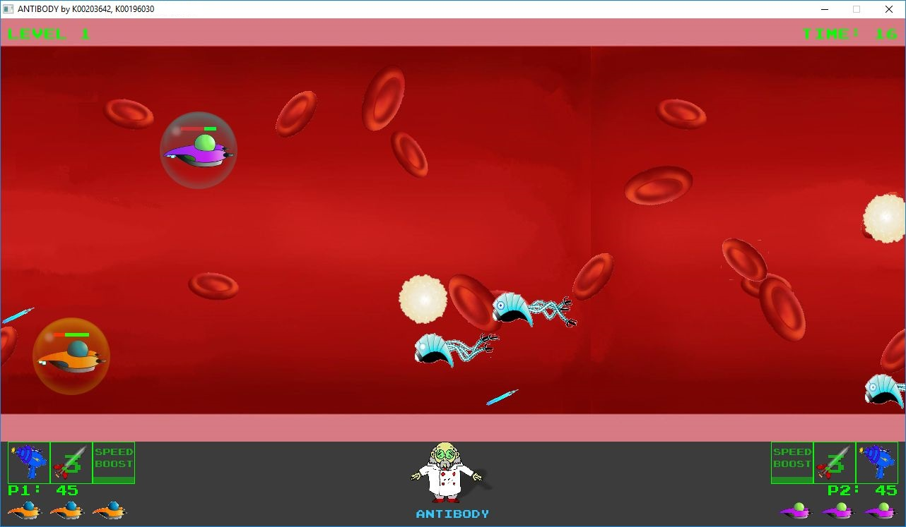
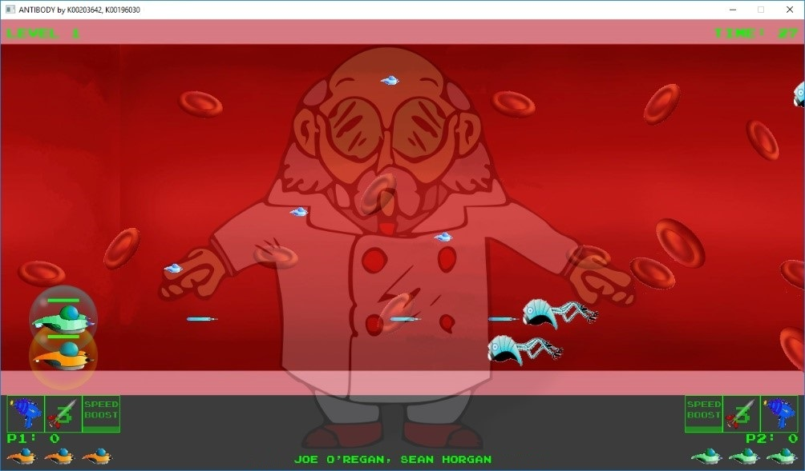
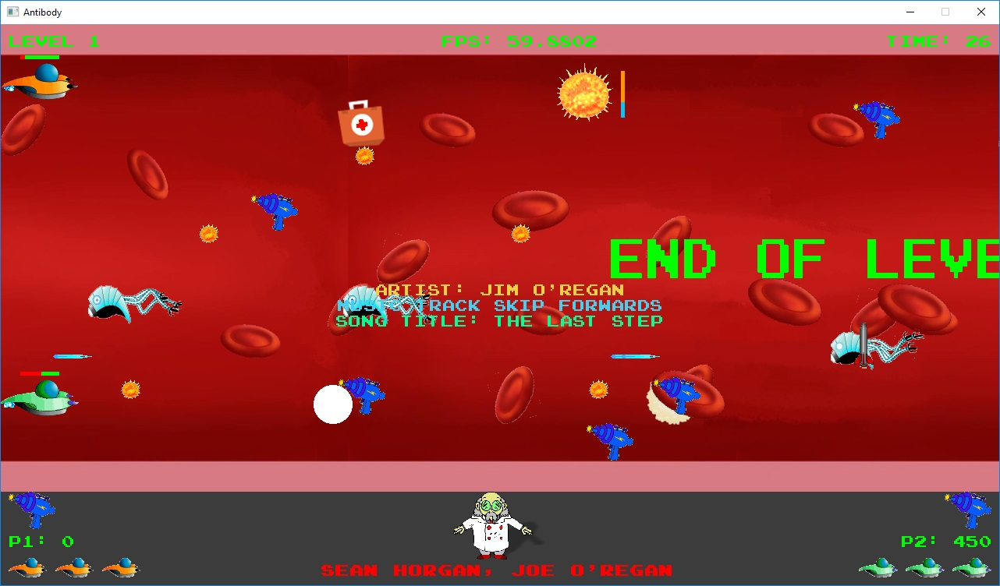
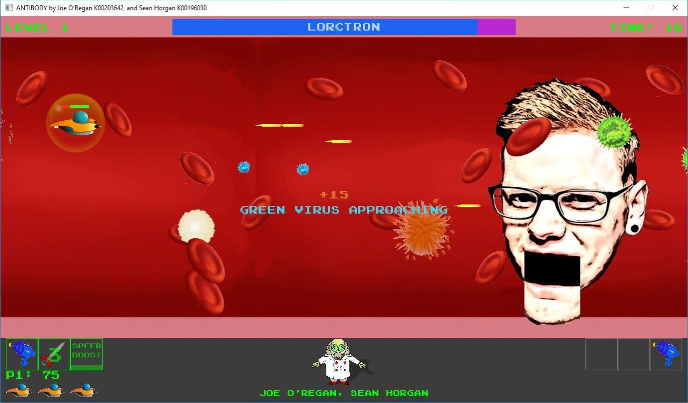
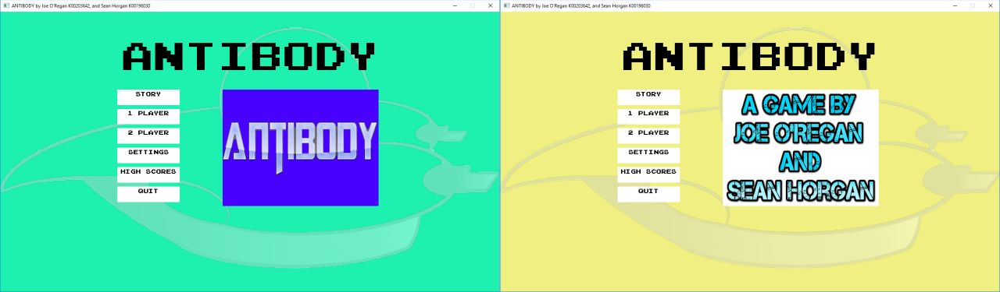
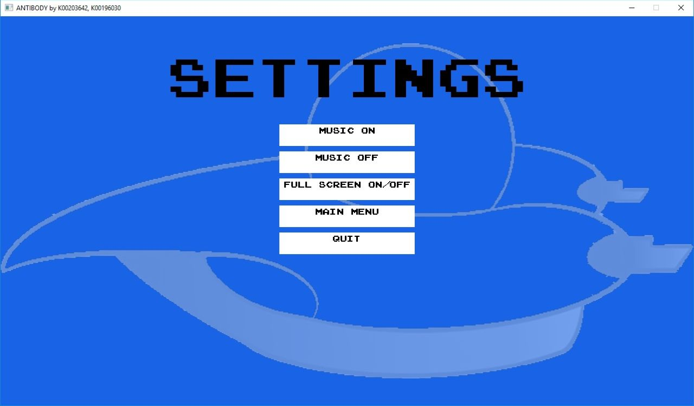

<link href="styles.css" rel="stylesheet"></link>

![LIT](https://img.shields.io/badge/Limerick%20Institute%20of%20Technology-2017-red?style=flat-square&logo=data:image/svg+xml;base64,PD94bWwgdmVyc2lvbj0iMS4wIiBlbmNvZGluZz0iVVRGLTgiIHN0YW5kYWxvbmU9Im5vIj8+CjwhLS0gQ3JlYXRlZCB3aXRoIElua3NjYXBlIChodHRwOi8vd3d3Lmlua3NjYXBlLm9yZy8pIC0tPgoKPHN2ZwogICB3aWR0aD0iNTYuMzI5OTQ4bW0iCiAgIGhlaWdodD0iNTYuODY3NzgzbW0iCiAgIHZpZXdCb3g9IjAgMCA1Ni4zMjk5NDggNTYuODY3NzgzIgogICB2ZXJzaW9uPSIxLjEiCiAgIGlkPSJzdmcxIgogICB4bWw6c3BhY2U9InByZXNlcnZlIgogICB4bWxucz0iaHR0cDovL3d3dy53My5vcmcvMjAwMC9zdmciCiAgIHhtbG5zOnN2Zz0iaHR0cDovL3d3dy53My5vcmcvMjAwMC9zdmciPjxkZWZzCiAgICAgaWQ9ImRlZnMxIiAvPjxnCiAgICAgaWQ9ImxheWVyMSIKICAgICB0cmFuc2Zvcm09InRyYW5zbGF0ZSgtMTAwLjgwNjE2LC0xMTEuMDAxNTMpIj48cGF0aAogICAgICAgZD0ibSAxMjMuMzIyMzgsMTExLjYxNTU4IGMgMy43MDQxNiwtMC43NjcyOSA3LjUxNDE2LC0wLjgyMDIxIDExLjI0NDc5LC0wLjEzMjI5IGwgLTIuMzU0NzksMTIuNDYxODcgYyAtMC45NTI1LC0wLjE4NTIgLTEuOTMxNDYsLTAuMjY0NTggLTIuOTEwNDIsLTAuMjY0NTggLTUuNzY3OTIsMCAtMTEuMDU5NTgsMy4xMjIwOCAtMTMuODM3NzEsOC4xNDkxNyBsIC00LjE4MDQyLC0yLjI3NTQyIGMgMi44ODM5NiwtNS4yMTIyOSA3Ljg1ODEzLC04LjkxNjQ2IDEzLjcwNTQyLC0xMC4xODY0NiB6IG0gNi42OTM5NSwyMi4xNzIwOCBjIC0wLjIzODEyLC0wLjAyNjQgLTAuNDc2MjUsLTAuMDUyOSAtMC43MTQzNywtMC4wNTI5IC0xLjY0MDQyLDAgLTMuMjAxNDYsMC43MTQzNyAtNC4yNTk3OSwxLjkzMTQ2IGwgLTIuNjk4NzUsLTIuMzU0OCBjIDEuNzcyNzEsLTIuMDEwODMgNC4zMTI3MSwtMy4xNDg1NCA2Ljk4NSwtMy4xNDg1NCAwLjM3MDQxLDAgMC43NjcyOSwwLjAyNjUgMS4xMzc3MSwwLjA3OTQgeiBtIDE5LjU1MjcxLDI1LjYzODEzIGMgLTYuNjY3NSw2LjcyMDQyIC0xNi4yMTg5Niw5LjY4Mzc1IC0yNS41MzIyOSw3Ljk2Mzk2IGwgMS40ODE2NywtNy43Nzg3NSBjIDYuNzIwNDEsMS4yNDM1NCAxMy41OTk1OCwtMC44OTk1OSAxOC40MTUsLTUuNzQxNDYgeiBtIC0xMy42Nzg5NiwtMTMuNDkzNzUgNC42MzAyMSw0LjU1MDgzIGMgLTMuNjc3NzEsMy43MzA2MyAtOC45OTU4Myw1LjM3MTA0IC0xNC4xNTUyMSw0LjQxODU0IGwgMS4xOTA2MywtNi4zNzY0NSBjIDAuNTU1NjIsMC4xMDU4MyAxLjEzNzcxLDAuMTU4NzUgMS43MTk3OSwwLjE1ODc1IDIuNTEzNTQsMCA0Ljg2ODMzLC0wLjk3ODk2IDYuNjE0NTgsLTIuNzUxNjcgeiBtIC0xNy42NDc3LDQuNzA5NTggYyAxLjAwNTQxLDEuMDA1NDIgMi4xNDMxMiwxLjg1MjA5IDMuMzg2NjYsMi41NCBsIC0yLjMyODMzLDQuMTUzOTYgYyAtMS42MTM5NiwtMC44OTk1OCAtMy4wOTU2MywtMi4wMTA4MyAtNC40MTg1NCwtMy4zMDcyOSBsIC01LjU4MjcxLDUuNjM1NjIgYyAtNS40NTA0MiwtNS4zMTgxMiAtOC41MTk1OCwtMTIuNjIwNjIgLTguNDkzMTMsLTIwLjI0MDYyIDAsLTEuNzk5MTcgMC4xNTg3NSwtMy41OTgzMyAwLjUwMjcxLC01LjM3MTA0IGwgNy44MDUyMSwxLjUwODEyIGMgLTAuMjM4MTIsMS4yNyAtMC4zNzA0MiwyLjU2NjQ2IC0wLjM3MDQyLDMuODYyOTIgMCwyLjQwNzcxIDAuNDIzMzQsNC43ODg5NiAxLjI0MzU1LDcuMDY0MzcgbCA0LjQ3MTQ1LC0xLjY0MDQxIGMgLTAuOTc4OTUsLTIuNjcyMjkgLTEuMjE3MDgsLTUuNTgyNzEgLTAuNjg3OTEsLTguMzg3MjkgbCA2LjM3NjQ2LDEuMjQzNTQgYyAtMC4xMDU4NCwwLjU4MjA4IC0wLjE1ODc1LDEuMTY0MTYgLTAuMTU4NzUsMS43NDYyNSAwLDIuNDg3MDggMS4wMDU0MSw0Ljg2ODMzIDIuNzc4MTIsNi41ODgxMiB6IG0gMjQuNTc5NzksLTI2LjY0MzU0IDYuNTA4NzUsMTAuOTI3MjkgYyAwLjU1NTYyLDIuNDA3NzEgMC42NjE0NSw0LjkyMTI1IDAuMzE3NSw3LjM1NTQyIEwgMTM4LjQ4MywxNDAuNzE5NzUgYyAtMC4xMzIyOSwwLjk3ODk2IC0wLjQyMzMzLDEuOTA1IC0wLjg0NjY3LDIuODA0NTggbCAtMy4yNTQzNywtMS41NjEwNCBjIDEuMTM3NzEsLTIuMzAxODggMC42MDg1NCwtNS4xMDY0NiAtMS4zNDkzOCwtNi43OTk3OSBsIDIuMzU0OCwtMi42OTg3NSBjIDEuNDgxNjYsMS4yOTY0NiAyLjUxMzU0LDMuMDE2MjUgMi45MzY4Nyw0LjkyMTI1IGwgNi4zNSwtMS40Mjg3NSBjIC0wLjc0MDgzLC0zLjI1NDM4IC0yLjQ4NzA4LC02LjE5MTI1IC01LjAwMDYzLC04LjM4NzI5IHogbSA2LjUzNTIsMTAuOTAwODMgLTYuNTA4NzUsLTEwLjkyNzI5IGMgLTEuMzc1ODMsLTEuMjE3MDggLTIuOTEwNDEsLTIuMjIyNSAtNC41NTA4MywtMy4wMTYyNSBsIDMuNDY2MDQsLTcuMTQzNzUgYyA3LjgwNTIxLDMuNzgzNTQgMTMuNDY3MjksMTAuOTAwODQgMTUuMzcyMjksMTkuMzQxMDQgeiIKICAgICAgIHN0eWxlPSJmaWxsOiNkNzFkMWU7c3Ryb2tlLXdpZHRoOjAuMjY0NTgzIgogICAgICAgaWQ9InBhdGgxLTgiIC8+PC9nPjxzdHlsZQogICAgIHR5cGU9InRleHQvY3NzIgogICAgIGlkPSJzdHlsZTEiPgoJLnN0MHtmaWxsOiNENzFEMUU7fQo8L3N0eWxlPjwvc3ZnPgo=)

    
   
  

---

## Limerick Institute of Technology: BSc Computing (Games Design and Development)

### Year 3 (2016/17), Semesters 5 and 6

#### Third-Year Group Project

Created by [Joe O'Regan (K00203642)](https://github.com/joeaoregan) and [Sean Horgan (K00196030)](https://github.com/sean-horgan)

---

## 📖 About

Antibody is a 2D sidescrolling game create using C++ and the Simple DirectMedia Layer (SDL 2) cross-platform software development library.

> [!TIP]
> To set up an SDL project starting from scratch, the information needed for a number of platforms and IDE is available in the [Lazy Foo' SDL tutorials](http://lazyfoo.net/tutorials/SDL/)

---

## 🎮 Features

- [System Design](https://joeaoregan.github.io/LIT-Yr3-Project-Antibody/system-design/)

### Core Systems

- **State Management**: Uses a state-based architecture (e.g., StatePlay, SplashScreen, EnterName) for clean transitions between menus and gameplay.
- **Physics & Collisions**: Custom collision detection (CollisionStuff.h) handling interactions between players, enemies, and environmental hazards.
- **Input Handling**: Support for both Keyboard and Gamepads (Gamepad.h).
- **Frame Rate Control**: Integrated FPS management (FPS.h and Timer.h) to ensure consistent gameplay speed.

### Gameplay Mechanics
- **Entity Inheritance**: A robust OOP structure with GameObjectAbstract serving as the base for Player, Enemy, and PowerUp.
- **Diverse Arsenal**: Multiple weapon types including Lasers, Rockets, Saws, and Ninja Stars.
- **Enemy Variety**: Specialized AI types including EnemyShip, EnemyVirus, and environmental Blockage.
- **Scoring & Persistence**: High score entry system (EnterName.h) and dynamic score text rendering.

### Visuals & Audio
- **Particle System**: Dedicated system for effects like explosions and blood cell interactions (Particle.cpp).
- **Scrolling Backgrounds**: Support for parallax or continuous background movement.
- **Dynamic HUD**: Real-time health bars (StatusBar.h) and heads-up display info.
- **Full Audio Suite**: Integration with SDL_mixer for music and sound effects management.

---

## 🛠️ Versions

1. **Journey To The Center Of My Headache**: Original Game Title.
2. **Games Fleadh Entry Version**: Games Fleadh award winning entry from 8th of March, 2017.
3. **Third-Year Project Submission**: An improved version of Games Fleadh entry.
4. **CodeBlocks**: This is an adapted version of the third-year project submission version of Antibody 2D, so the project can be compiled in Code::Blocks, and run without the need for Visual Studio DLLs.

> [!NOTE]
> "Files Commont To V2 and V3/" contains files commong to the Games Fleadh entery and Project Submission.

---

## 🚀 Releases

Playable versions of game, bare in mind, the game is incomplete

[Release Page](https://github.com/joeaoregan/LIT-Yr3-Project-Antibody/releases)

---

## 🏆 Awards

**Best Windows Game** at [Games Fleadh 2017](http://gamesfleadh.ie/results/)

---

## 📸 Screenshots (Updated 31/01/2018)

 
 
 
 

Click here for larger images, or individual thumbnails to go to raw images.

###### Antibody 2D: 2 Player Local Multiplayer

---

###### Antibody 2D: Menu System

---

###### Antibody 2D: Settings Menu

---

###### Antibody 2D: Map

---

###### Antibody 2D: Virus Enemies, Information Messages, and Power Ups

---

###### Antibody 2D: End Of Level Boss

---

###### Antibody 2D: Power Ups for time, health, lasers, lives, rockets

---

###### Split screen race mode

---

  
1. 🔗 Links

### Additional Repos:

#### 1. Year-Four Networked Games Project

As part of my forth-year project, I started creating a networked version of the game in Linux. The code base is cross platform, and I've included a finite state machine to help eliminate some of the problems with the original game.

[Yr4-Project-Networked-Games-Library Repo](https://github.com/joeaoregan/Yr4-Project-Networked-Games-Library)

#### 2. AntibodyPy

A Python based version of the game

[AntibodyPy Repo](https://github.com/joeaoregan/AntibodyPy)

---

  
2. 🎵 Media

Game Trailer by Seán Horgan, and Original Game Tracks by Joe O'Regan

<table>
<tr>
    <th>Game Trailer</th><th colspan=2>Soundtrack</th>
</tr>
<tr>
    <td><a href="https://youtu.be/HQiAlmhXLqA"> YouTube Trailer</a></td>
    <td><a href="https://youtu.be/ibIjSwFLAGo"> 1. Blood Level</a></td>
    <td><a href="https://youtu.be/sHVVEVyt4xQ"> 2. Virus</a></td>
</tr>
<tr>
    <td>by Seán Horgan</td>
    <td colspan=2>by Joe O'Regan</td>
</tr>
</table>

---

  
3. 📚 References

### References:

[Lazy Foo' Productions: Beginning Game Programming v2.0](http://lazyfoo.net/tutorials/SDL/)

[SDL Game Development by Shaun Mitchell](https://www.packtpub.com/game-development/sdl-game-development)

---

&copy; 2017 Joe O'Regan &bull; LIT | Group Project

[⬆️ Back to Top](https://github.com/joeaoregan/LIT-Yr3-Project-Antibody)

