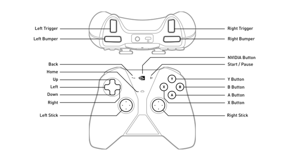
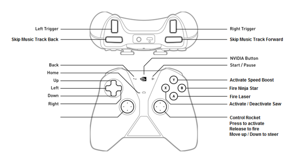

# Game Controls

## Keyboard Controls

<!--  -->
<!--  -->

<!-- { pre_inline="true" } -->

--8<-- "images/svg/keyboard_controls.svg"

!!! info "Default Input"  
    The game uses the keyboard as the primary input device, divided into general system keys, Player 1 controls (Red/White Ship), and Player 2 controls (Blue Ship).

---

### Keyboard Controls

| Player 1 | Player 2 | Action & Description |
| :---: | :---: | :--- |
| **A** | **←** | Move left through arterial vessel |
| **S** | **↓** | Move down |
| **D** | **→** | Move right |
| **W** | **↑** | Move up |
| **E** | **R** | Activate / Deactivate Perimeter Saw (shield deactivates when Saw is active, and vice versa) |
| **F** | **G** | Activate Speed Boost (lasts 3.0 seconds; remaining duration displayed on the HUD status bar) |
| **C** | **V** | Hold to charge rocket ordnance power bar; release to fire (*see note below*) |
| **Keypad -** | **Keypad -** | Pitch rocket elevation upwards (decreases Y-axis position) |
| **Keypad +** | **Keypad +** | Pitch rocket elevation downwards (increases Y-axis position) |
| **Spacebar** | **Right Ctrl** | Fire primary laser cannons (Single / Twin / Triple beams) |
| **N** | **Right Shift** | Fire rotating ninja star (slices large viruses in half) |

!!! note "Rocket Overcharge Status Warning"  
    If the **C** (Player 1) or **V** (Player 2) key is not released before the rocket power bar fills completely, the rocket will self-destruct internally.

!!! tip "Weapon Power Bar Strategy"  
    Holding the rocket fire key charges missile kinetic potency for higher point multipliers, but releasing it just before the threshold guarantees safe launch past defensive plaque walls.

---

### System & Jukebox Controls

* **Esc**: Pause gameplay / Return to Main Menu from any active sub-menu
* **F1**: Toggle real-time rolling Frames Per Second (FPS) diagnostic counter
* **T**: Toggle full-screen procedural game map and boss checkpoints
* **Enter**: Confirm player handle on the high-score text entry screen
* **0**: Stop background music playback
* **K**: Skip active music track backwards
* **L**: Skip active music track forwards
* **M**: Toggle music track pause / resume

---

## Gamepad Controls

!!! info

    The game supports game controllers (such as the NVIDIA Shield Controller layout shown in images above). Directional pads handle ship movement, and controller buttons map to core actions like firing weapons and activating specials.