# Collisions & AABB Intersection Pipeline



Collision detection in **AntiBody** is managed via Axis-Aligned Bounding Box (**AABB**) intersection testing declared in `CollisionStuff.h` and executed across the entity vector each frame in `Game::update()`.

---

## 1. Mathematical Logic (`CollisionStuff.h`)

Every interactive game object inherits an `SDL_Rect` bounding volume (`mBox`) mapped to its position and visual dimensions. The `checkCollision(SDL_Rect *a, SDL_Rect *b)` algorithm checks for separating planes across the horizontal and vertical axes:

```cpp
bool Game::checkCollision(SDL_Rect *a, SDL_Rect *b) {
    int leftA = (*a).x,          rightA = (*a).x + (*a).w;
    int topA  = (*a).y,          bottomA = (*a).y + (*a).h;
    int leftB = (*b).x,          rightB = (*b).x + (*b).w;
    int topB  = (*b).y,          bottomB = (*b).y + (*b).h;

    // 1. Separating axis tests
    if (bottomA <= topB) return false; // Box A is completely above Box B
    if (topA >= bottomB) return false; // Box A is completely below Box B
    if (rightA <= leftB) return false; // Box A is completely left of Box B
    if (leftA >= rightB) return false; // Box A is completely right of Box B

    // 2. Overlap occurs across both axes simultaneously
    return true;
}
```

!!! note "Performance of AABB Bounding Volumes"  
    AABB collision detection relies exclusively on integer arithmetic comparisons without square roots or trigonometric functions, enabling dozens of concurrent bullet, enemy, and particle checks within the 60 FPS tick budget.

---

## 2. Event Dispatch & Collision Resolution Matrix

When `checkCollision()` returns `true`, the engine executes context-specific game mechanics based on object types:

| Intersecting Entities | Resolution & Gameplay Mechanics | Audio & Visual Feedback |
| :--- | :--- | :--- |
| **Player Weapon $\leftrightarrow$ Enemy** | Decrements target hit points; Ninja Stars and Saws split viral cells; rockets trigger area blast damage. | Spawns floating `ScoreValueText`, triggers particle burst, and plays explosion SFX. |
| **Player Ship $\leftrightarrow$ Power-Up** | Restores ship hit points (`HealthBox`), cycles primary cannons (`LaserBox`), or awards extra lives. | Plays `Audio::playFX(POWERUP_FX)` and disposes the collectible instance. |
| **Player Ship $\leftrightarrow$ Enemy / Plaque** | Depletes player shield/health bar (`StatusBar`) and triggers temporary invulnerability respawn flashing. | Orange Viruses detonate on contact; health zero drops player lives. |
| **Projectile $\leftrightarrow$ Viewport Boundary** | Cleans up bullets leaving the screen (`destroy()`) to prevent memory leaks; rockets detonate against wall plaque. | Trigger terminal explosion animation for exploding ordnance. |

---

## 3. Historical Development & Milestones

* **2017/01/07**: Initial `SDL_Rect` bounding volume created for enemy objects.
* **2017/01/11**: Transitioned from raw linked lists to `std::vector` for active lasers, enabling multi-object collision bounding and player damage flashing.
* **2017/01/17**: Implemented rotational bounding boxes for Ninja Stars and spinning Saws.
* **2017/01/25**: Added explosive kinetic impact reaction for colliding Orange Viruses.
* **2017/02/08**: Added boundary collision detection triggering steerable rocket detonations.
* **2017/02/21**: Introduced conditional slicing checks so that only Ninja Stars and Saws fragment virus satellites into mini-cells.
