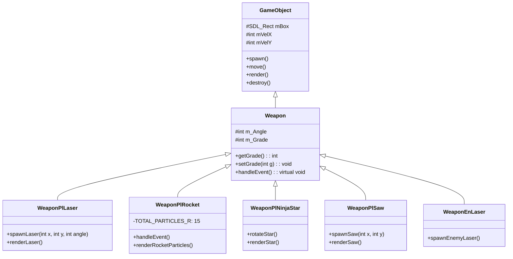

# Weapon Arsenal & Projectile Systems

All ballistic, piercing, and energy ordnance in **AntiBody** inherit from the polymorphic base class `Weapon` (`Weapon.h`), which extends `GameObject`.

---

## 1. Weapon Class Characteristics & Comparison Matrix

| Weapon Type | Class Header | Ammo Mode | Velocity | Damage / Potency | Unique Combat Mechanics |
| :--- | :--- | :--- | :--- | :--- | :--- |
| **Primary Laser** | `WeaponPlLaser.h` | Unlimited | Fast ($800\text{ px/s}$) | $10\text{ HP / beam}$ | Progresses from Single $\rightarrow$ Twin $\rightarrow$ Triple Spread $(-15^\circ, 0^\circ, +15^\circ)$ via Laser Power-ups. |
| **Steerable Rocket** | `WeaponPlRocket.h` | Stock (Pickups) | Accelerating | $100\text{ HP (Kinetic)}$ | Player-guided via analog stick (`handleEvent()`); emits 15 particle sparks; detonates on walls. |
| **Ninja Star** | `WeaponPlNinjaStar.h` | Unlimited | Medium ($450\text{ px/s}$) | $35\text{ HP (Piercing)}$ | Rotates in flight; **slices viruses in half** into smaller cells; distinct colors (Yellow P1 / Blue P2). |
| **Protective Saw** | `WeaponPlSaw.h` | Timed Shield | Ship-Anchored | $50\text{ HP (Continuous)}$ | Close-range melee saw shield; grants damage invulnerability and deflects incoming enemy energy bolts. |
| **Enemy Pulse Laser** | `WeaponEnLaser.h` | Timed Barrage | Medium ($500\text{ px/s}$) | $15\text{ HP (Player Hit)}$ | Discharged by Boss multi-cannons, Nano-bots (`EnemyShip`), and Blue Virus orbital satellites. |

---

## 2. Weapon Sub-Tree Inheritance

---

## 3. Virus Slicing & Tactical Mechanics

!!! tip "Viral Slicing with Saws & Ninja Stars"  
    Unlike conventional lasers that destroy organisms outright, **Ninja Stars** (`WeaponPlNinjaStar`) and **Perimeter Saws** (`WeaponPlSaw`) are engineered to slice large `EnemyVirus` entities into two smaller, fragmented virus particles. These smaller organisms carry lower health pools, allowing friendly **White Blood Cells** to consume them autonomously.

* **Rocket Ordinance Inventory**: Rockets are non-renewable munitions replenished exclusively through `PowerUpRocket` collectible crates. A dedicated rocket icon in the viewport HUD tracks remaining stock.
* **Close-Range Saw Risk vs Reward**: Activating `WeaponPlSaw` grants front-facing invulnerability against standard projectile hits, but requires close proximity to hazardous arterial walls and exploding Orange Viruses.
