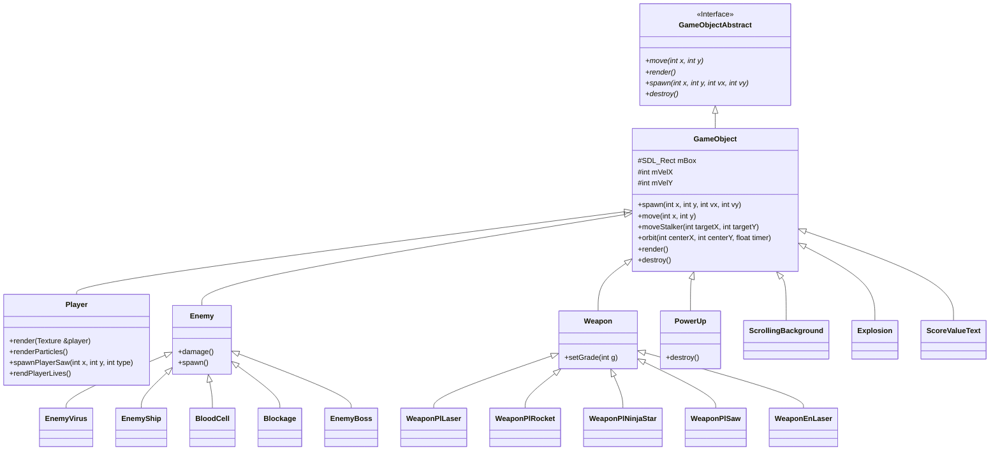

# System Design & Configuration

The architecture of **AntiBody** is structured using C++ and the **SDL2** library. It employs object-oriented principles such as inheritance, polymorphism, and the Singleton design pattern to manage game systems, rendering, physics, and state transitions.

---

## 1. Polymorphic Entity Hierarchy

Every interactive game object in AntiBody derives from the pure virtual interface `GameObjectAbstract`, routed through the base implementation `GameObject`:

---

## 2. Core Architecture Subsystems

* **Player Submarines (`Player`)**: Controls Player 1 (Red/White) and Player 2 (Blue) ships, handling directional propulsion, particle bubble emitters, weapon cycling, and invulnerability blinking.
* **Enemy Ecosystem (`Enemy`)**:
  - `EnemyVirus`: Autonomous viral organisms in Green, Orange, and orbital Blue variants.
  - `EnemyShip`: Fast-moving nano-bot vessels firing targeted energy bolts.
  - `BloodCell`: Passive arterial cells (Large, Small, White) that act as kinetic obstacles.
  - `Blockage`: Dense cholesterol plaque formations obstructing blood vessels.
  - `EnemyBoss`: Multi-phase end-of-stage encounters with composite health bars.
* **Weapons Arsenal (`Weapon`)**: High-velocity lasers (`WeaponPlLaser`), tracking ordnance (`WeaponPlRocket`), spinning piercing weapons (`WeaponPlNinjaStar`), close-range perimeter shields (`WeaponPlSaw`), and enemy laser barrages (`WeaponEnLaser`).
* **Environmental & FX Systems**: Dual-speed parallax vessel walls (`ScrollingBackground`), animated particle bubble exhausts (`Particle`), splatter explosions (`Explosion`), and floating combat score notifications (`ScoreValueText`).

!!! tip "Design Patterns & Performance"  
    Core managers like `Audio` and `Texture` utilise the **Singleton design pattern** (`s_pInstance`) to provide global access to shared assets and eliminate redundant loader calls. All entity bounding boxes (`mBox`) map directly to `SDL_Rect` structures for accelerated AABB collision detection.
